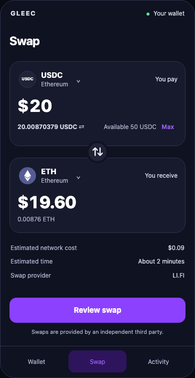
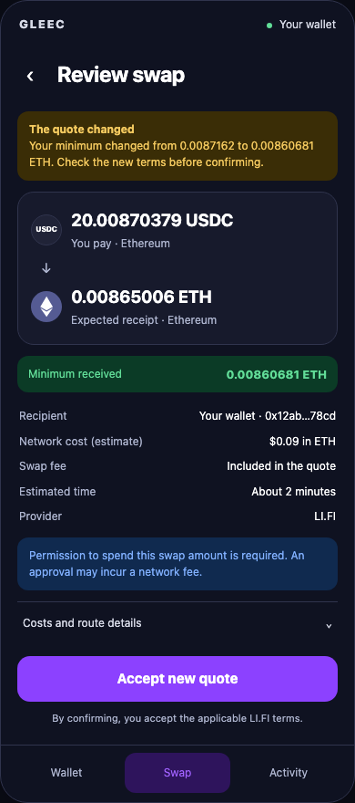
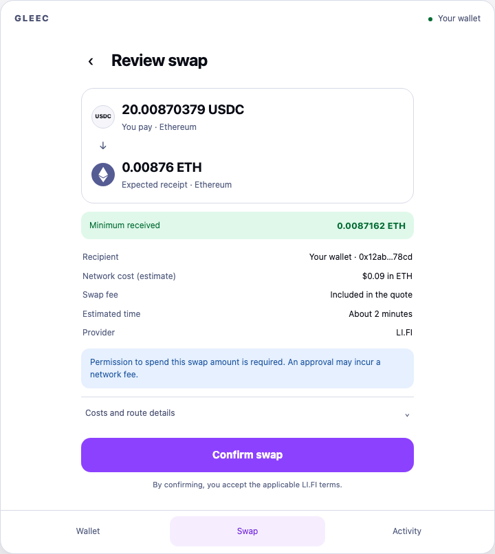

# Reference validation

Validated on 2026-11-08 in an isolated headless Chrome profile. This record
applies only to the self-contained HTML reference, not the Flutter app.

- **20/20 fixture checks passed.** [The repeatable check](browser-checks.js)
  can be supplied as the function argument to Chrome DevTools
  `evaluate_script` after opening `../index.html`.
- Checked selection/search, typing focus, retained input, compact review,
  expandable details, changed-term acceptance, starting/receiving distinction,
  continuing execution after leaving progress, receipt reopen without replay,
  pending balance refresh, reduced motion, stable quote geometry, and Max.
- Inspected light and dark themes at phone and wide frame widths. Desktop
  viewport: 1280 × 1000; app frames: 390 px and 720 px. Mobile emulation:
  390 × 844 with touch, giving a 362 px frame inside the reference-page margins.
  No horizontal page overflow; the phone form's buttons retain 44 px minimum
  height. Expanded disclosures and exceptional warnings may require scrolling.
- Ready/loading/slow/failed form states keep identical receive-card, quote-area,
  and primary-action geometry. Picker/review transitions and local quote/receipt
  effects have separate focus; money values are replaced immediately.
- Explicit reduced motion and emulated `prefers-reduced-motion: reduce` both
  remove the receipt animation. Browser console has no errors or warnings.
- JavaScript syntax check passed. No network requests, external assets,
  credentials, or real wallet actions are involved.

These checks do not measure app latency, native frame timing, a phone keyboard,
native haptics, screen-reader usability, real funding, or settlement. Those
remain separate gates in [the delivery record](../../../SWAP_UX_DELIVERY.md).

## Captures

The captures are authored reference states, not Flutter screenshots.

